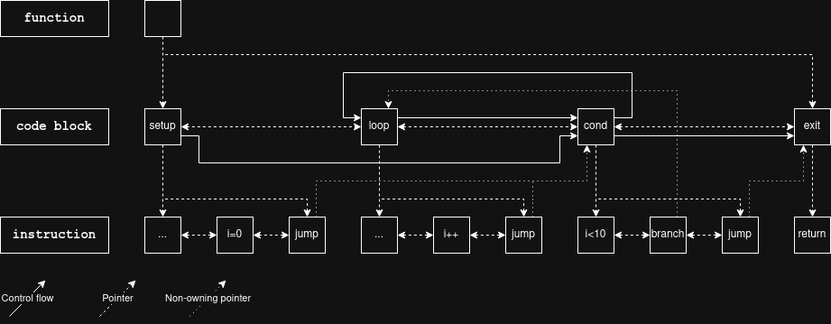
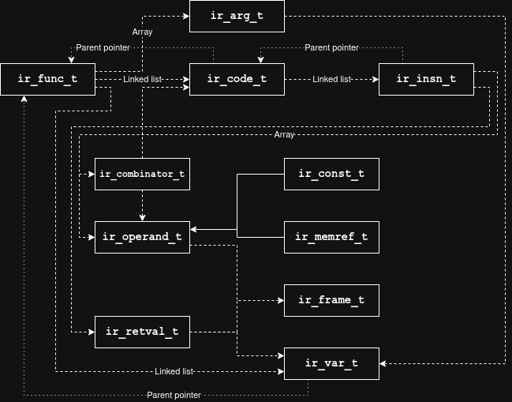

# Lily Intermediate Representation
Lily-CC employs an assembly-like intermediate representation for optimization and code generation. The most notable structures are functions (`ir_func_t`), code within said functions (`ir_code_t`) and pseudo-registers (`ir_var_t`). Lily-CC is built out of multiple smaller libraries and the intermediate representation is the very core of the compiler. It is found in the library [`compiler-common`](../src/compiler/common/). It is expected that languages targetting Lily-CC IR depend directly on this library.

This specification will use simplified snippets from [ir/ir_types.h](../src/compiler/common/ir/ir_types.h). Any relevant fields and type names will remain the same, but redundant information or private fields will be stripped.

## Table of Contents
- [Examples](#examples)
    - [Example: for loop](#example-for-loop)
- [IR Library](#ir-library)
    - [Data types](#data-types)
    - [Structures overview](#structures-overview)
    - [Struct: Function](#struct-function)
    - [Struct: Function argument](#struct-function-argument)
    - [Struct: Code block](#struct-code-block)
    - [Struct: Instruction](#struct-instruction)
    - [Struct: Operand](#struct-operand)
    - [Struct: Return value](#struct-return-value)
    - [Struct: Variable](#struct-variable)
    - [Struct: Constant](#struct-constant)
    - [Struct: Memory reference](#struct-memory-reference)
    - [Struct: Combinator entry](#struct-combinator-entry)
    - [Struct: Stack frame](#struct-stack-frame)
    - [Enumaration: Primitive type](#enumaration-primitive-type)
    - [Enumaration: Binary operator](#enumaration-binary-operator)
    - [Enumaration: Unary operator](#enumaration-unary-operator)
    - [Enumaration: Instruction type](#enumaration-instruction-type)
    - [Enumaration: Operand type](#enumaration-operand-type)
    - [Enumaration: Base address type](#enumaration-base-address-type)
    - [Enumaration: Argument type](#enumaration-argument-type)
- [Instructions](#instructions)
    - [Binary computation instructions](#binary-computation-instructions)
        - [Instruction: `sgtu`](#instruction-sgtu)
        - [Instruction: `sleu`](#instruction-sleu)
        - [Instruction: `sltu`](#instruction-sltu)
        - [Instruction: `sgeu`](#instruction-sgeu)
        - [Instruction: `sgts`](#instruction-sgts)
        - [Instruction: `sles`](#instruction-sles)
        - [Instruction: `slts`](#instruction-slts)
        - [Instruction: `sges`](#instruction-sges)
        - [Instruction: `seq`](#instruction-seq)
        - [Instruction: `sne`](#instruction-sne)
        - [Instruction: `add`](#instruction-add)
        - [Instruction: `sub`](#instruction-sub)
        - [Instruction: `mul`](#instruction-mul)
        - [Instruction: `divu`](#instruction-divu)
        - [Instruction: `remu`](#instruction-remu)
        - [Instruction: `divs`](#instruction-divs)
        - [Instruction: `rems`](#instruction-rems)
        - [Instruction: `shl`](#instruction-shl)
        - [Instruction: `shru`](#instruction-shru)
        - [Instruction: `shrs`](#instruction-shrs)
        - [Instruction: `band`](#instruction-band)
        - [Instruction: `bor`](#instruction-bor)
        - [Instruction: `bxor`](#instruction-bxor)
    - [Unary computation instructions](#unary-computation-instructions)
        - [Instruction: `mov`](#instruction-mov)
        - [Instruction: `zeroext`](#instruction-zeroext)
        - [Instruction: `signext`](#instruction-signext)
        - [Instruction: `bitcast`](#instruction-bitcast)
        - [Instruction: `seqz`](#instruction-seqz)
        - [Instruction: `snez`](#instruction-snez)
        - [Instruction: `neg`](#instruction-neg)
        - [Instruction: `bneg`](#instruction-bneg)
    - [Memory instructions](#memory-instructions)
        - [Instruction: `lea`](#instruction-lea)
        - [Instruction: `load`](#instruction-load)
        - [Instruction: `store`](#instruction-store)
    - [Control flow instructions](#control-flow-instructions)
        - [Instruction: `jump`](#instruction-jump)
        - [Instruction: `branch`](#instruction-branch)
        - [Instruction: `call`](#instruction-call)
        - [Instruction: `return`](#instruction-return)
    - [Intrinsics instructions](#intrinsics-instructions)
        - [Instruction: `memcpy`](#instruction-memcpy)
        - [Instruction: `memset`](#instruction-memset)
        - [Instruction: `clobber`](#instruction-clobber)
        - [Instruction: `alloca`](#instruction-alloca)
        - [Instruction: `callframe_enter`](#instruction-callframe_enter)
        - [Instruction: `callframe_exit`](#instruction-callframe_exit)
        - [Instruction: `mark_used`](#instruction-mark_used)
        - [Instruction: `epilogue`](#instruction-epilogue)
    - [Misc instructions](#misc-instructions)
        - [Instruction: `comb`](#instruction-comb)
- [Text representation](#text-representation)
    - [Literals](#literals)
    - [Operands](#operands)
        - [Phi-Node Bindings](#phi-node-bindings)
    - [Directives](#directives)
        - [Directive: Function Entrypoint](#directive-function-entrypoint)
        - [Directive: Function Argument](#directive-function-argument)
        - [Directive: Code Block](#directive-code-block)
        - [Directive: Variable Definition](#directive-variable-definition)
        - [Directive: Stack Frame Definition](#directive-stack-frame-definition)
    - [List of keywords](#list-of-keywords)
        - [Keywords alphabetically](#keywords-alphabetically)
        - [Keywords in order](#keywords-in-order)
- [Known Issues](#known-issues)
    - [Struct ABI note](#struct-abi-note)
    - [Long double note](#long-double-note)

# Examples

## Example: For loop
The following C code:
```c
void functor() {
    ...
    for (int i = 0; i < 10; i++) {
        ...
    }
}
```

Might be compiled into the following IR:
```
function functor
    entry %setup
    var %i i32
    var %var1
code %setup
    ...
    %i = mov s32'0
    jump %cond
code %loop
    ...
    %i = add %i, s32'1
    jump %cond
code %cond
    %var1 = slt %i, s32'10
    branch %loop, %var1
    jump %exit
code %exit
    ret
```

And produce an in-memory representation as shown:



# IR Library
The [ir](../src/compiler/common/ir/) subfolder of the [`lilycc`](../src/compiler/common/) library is the intended way of interacting with the IR from the perspective of both the frontend and the backend. It is to be treated as the source of truth for the IR specification. This section presents an overview of the specification in a more human-readable format.

## Data types
The types that values (e.g. variables and constants) can have. Every data type has a fixed size and alignment equal to the size. All integer types are to be stored in two's complement. The size of a byte is exactly 8 bits and a byte must be the minimum addressable unit of memory.

Lily-CC IR does not tag integer types with a sign directly. Instead, specific sites w.r.t. function calls can be tagged with a sign-extension preference to the register width. If unspecified, the value will not be truncated (i.e. assumes no overflow). This applies to `call` instruction operands (in `ir_operand_t`), function arguments (`ir_funcarg_t`) and function returns (`ir_funcret_t`). For instructions where sign-extension matters (e.g. `divs` vs `divu`), Lily-CC emits `signext` and `zeroext` automatically as needed.

Note: Lily-CC support for floating-point numbers is unfinished and thereby not currently completely usable.

| Type   | C equivalent                 | Size (bytes) | Description
| :----- | :--------------------------- | -----------: | :----------
| `i8`   | `int8_t`     / `uint8_t`     |            1 | 8-bit integer.
| `i16`  | `int16_t`    / `uint16_t`    |            2 | 16-bit integer.
| `i32`  | `int32_t`    / `uint32_t`    |            4 | 32-bit integer.
| `i64`  | `int64_t`    / `uint64_t`    |            8 | 64-bit integer.
| `i128` | `__int128_t` / `__uint128_t` |           16 | 128-bit integer.
| `bool` | `bool`                       |            1 | One-bit truth value.
| `f32`  | `f32`                        |            4 | IEEE 754 binary32 floating-point number.
| `f64`  | `f64`                        |            8 | IEEE 754 binary64 floating-point number.

## Structures overview

The IR consists of the following structs:
| Name              | Struct            | Brief
| :---------------- | :---------------- | :----
| Function          | `ir_func_t`       | A collection of code blocks with calling convention information.
| Function argument | `ir_funcarg_t`    | How an argument is passed to a function.
| Code block        | `ir_code_t`       | A single node in the control-flow graph.
| Instruction       | `ir_insn_t`       | One abstract operation to perform at run-time.
| Operand           | `ir_operand_t`    | Operand for an instruction. Could be memory, variables, constants, etc.
| Return value      | `ir_retval_t`     | Destination of an instruction; for most, this is a variable.
| Variable          | `ir_var_t`        | Pseudo-register with a fixed data type.
| Constant          | `ir_const_t`      | A value known at compile-time.
| Memory reference  | `ir_memref_t`     | Describes a location in memory with optional data type.
| Combinator entry  | `ir_combinator_t` | Tuple of predecessor node and value binding for phi-nodes.
| Stack frame       | `ir_frame_t`      | Abstract fixed-size stack allocation.

And the following enumerations:
| Name              | Enumeration         | Brief
| :---------------- | :------------------ | :----
| Primitive type    | `ir_prim_t`         | Data types for IR operations
| Binary operator   | `ir_op2_type_t`     | Operator type for `IR_INSN_EXPR2`.
| Unary operator    | `ir_op1_type_t`     | Operator type for `IR_INSN_EXPR1`.
| Instruction type  | `ir_insn_type_t`    | Instruction type
| Operand type      | `ir_operand_type_t` | Union tag for `ir_operand_t`.
| Base address type | `ir_membase_t`      | Union tag for `base_*` in `ir_memref_t`.
| Argument type     | `ir_funcarg_type_t` | Union tag for `ir_funcarg_t`.

The following diagram depicts how structures relate to one another and are embedded by each other:



See also: [Long double note](#long-double-note).

## Struct: Function
A collection of code blocks with calling convention information.

```c
struct ir_func {
    char      *name;
    size_t     args_len;
    ir_funcarg_t  *args;
    ir_code_t *entry;
    // ... private fields omitted ...
    bool       enforce_ssa;
};
```

Functions own stack frames, variables (pseudo-registers) and code blocks. The code blocks are stored in a doubly-linked list that correlates with how the code is to be scheduled in the final executable. In turn, the code blocks own linked lists of instructions, the abstract unit of run-time action. Functions can optionally be in SSA (Static Single Assignment) form, where the IR library will enforce that every variable is assigned at most once. A function may be converted into SSA form by calling `ir_func_to_ssa`, though there is no need for front-ends to do this.

Creating a function using `ir_func_create` will create an empty code block and assign it to `entry`. However, it is legal to replace `entry` with some other code block and it is also legal to then delete the original using `ir_code_delete`. Similarly, `args` is also initialized with default values that are expected to be modified by the frontend.

## Struct: Function argument
How an argument is passed to a function.

```c
struct ir_arg {
    ir_funcarg_type_t arg_type;
    ir_sign_t         sign;
    union {
        ir_var_t   *var;
        ir_frame_t *struct_frame;
        ir_prim_t   ignored_prim;
    };
};
```

Tagged union of variable, stack frame and data type. The information conveyed is used by the back-end to implement the calling convention of the function. Variable arguments are treated as the corresponding C type in the target ABI, and stack frame arguments are used to pass structs.

**WARNING: There are issues with structs in IR, please read the [struct ABI note](#struct-abi-note).**

## Struct: Code block
A single node in the control-flow graph.

```c
struct ir_code {
    // ... private fields omitted ...
    char        *name;
    ir_func_t   *func;
    // ... private fields omitted ...
};
```

The primary type used while emitting code. Most instructions are written by appending them to a code block, though it is also possible to prepend them or place them relative to an existing instruction. Created using `ir_code_create`, a new empty, disconnected code block is available for writing code into. It is legal for a code block to be unreachable, in which case it is optimized out. However, all reachable code blocks must end with either a `jump` or a `ret` IR instruction.

## Struct: Instruction
One abstract operation to perform at run-time.

```c
struct ir_insn {
    ir_code_t     *code;
    // ... private fields omitted ...
};
```

## Struct: Operand
Operand for an instruction. Could be memory, variables, constants, etc.

```c
struct ir_operand {
    ir_operand_type_t type;
    ir_sign_t         sign;
    union {
        ir_const_t  iconst;
        ir_prim_t   undef_type;
        ir_var_t   *var;
        ir_frame_t *struct_frame;
        ir_memref_t mem;
        size_t      regno;
    };
};
```


## Struct: Return value
Destination of an instruction; for most, this is a variable.


## Struct: Variable
Pseudo-register with a fixed data type.


## Struct: Constant
A value known at compile-time.

```c
struct ir_const {
    ir_prim_t prim_type;
    union {
        float  constf32;
        double constf64;
        struct {
            // Note: These fields are swapped on big-endian hosts.
            uint64_t constl;
            uint64_t consth;
        };
        i128_t const128;
    };
};
```

Constants, commonly constructed either by means of calculation through `ir_calc1`, `ir_calc2` and `ir_cast`, and through `IR_CONST_*()` function-like macros. Any bit-pattern is truncated automatically for any data type except `bool`, for which the value must always be `consth = 0` and `constl <= 1`.

## Struct: Memory reference
Describes a location in memory with optional data type. The data type is relevant for certain memory-access instructions, as registers may be larger than a byte. This allows the IR to retain the information needed for memory access in the code generation phase where variables are resized to the minimum register width.

```c
struct ir_memref {
    ir_membase_t base_type;
    ir_prim_t    data_type;
    union {
        char       *base_sym;
        ir_frame_t *base_frame;
        ir_code_t  *base_code;
        ir_var_t   *base_var;
        regno_t     base_regno;
    };
    int64_t offset;
};
```


## Struct: Combinator entry
Tuple of predecessor node and value binding for phi-nodes.


## Struct: Stack frame
Abstract fixed-size stack allocation.


## Enumaration: Primitive type
Data types for IR operations

```c
typedef enum {
    IR_PRIM_<type>, // for all IR data types
    IR_N_PRIM,
} ir_prim_t;
```

The array `ir_prim_sizes` can be indexed by a legal value of `ir_prim_t` (including `IR_N_PRIM`) to get the size (or 0) of said type. Similarly, `ir_prim_names` returns the name of the type (or `NULL`).

See also: [Data types](#data-types).

## Enumaration: Binary operator
Operator type for `IR_INSN_EXPR2`.

```c
typedef enum {
    IR_OP2_<operator>, // for all binary expression instructions
    IR_N_OP2,
} ir_op2_type_t;
```

Distinguishes computation instructions that take two values as operands and return one value.

See also:

## Enumaration: Unary operator
Operator type for `IR_INSN_EXPR1`.

```c
typedef enum {
    IR_OP1_<operator>, // for all unary expression instructions
    IR_N_OP1,
} ir_op1_type_t;
```

Distinguishes computations instructions that take one value as an operand and return one value.

See also:

## Enumaration: Instruction type
Instruction type.

```c
typedef enum {
    IR_INSN_EXPR2,
    IR_INSN_EXPR1,
    IR_INSN_JUMP,
    IR_INSN_BRANCH,
    IR_INSN_LEA,
    IR_INSN_LOAD,
    IR_INSN_STORE,
    IR_INSN_COMBINATOR,
    IR_INSN_CALL,
    IR_INSN_RETURN,
    IR_INSN_MEMCPY,
    IR_INSN_MEMSET,
    IR_INSN_MACHINE,
} ir_insn_type_t;
```

Distinguishes major categories of instruction and indirectly specifies their preconditions and invariants.

See also: [Instruction](#struct-instruction).

## Enumaration: Operand type
Union tag for `ir_operand_t`.

```c
typedef enum {
    IR_OPERAND_TYPE_CONST,
    IR_OPERAND_TYPE_UNDEF,
    IR_OPERAND_TYPE_VAR,
    IR_OPERAND_TYPE_MEM,
    IR_OPERAND_TYPE_STRUCT,
    IR_OPERAND_TYPE_REG,
} ir_operand_type_t;
```

See also: [Operand](#struct-operand).

## Enumaration: Base address type
Union tag for `base_*` in `ir_memref_t`.

```c
typedef enum {
    IR_MEMBASE_ABS,
    IR_MEMBASE_SYM,
    IR_MEMBASE_FRAME,
    IR_MEMBASE_CODE,
    IR_MEMBASE_VAR,
    IR_MEMBASE_REG,
} ir_membase_t;
```

See also: [Memory reference](#struct-memory-reference).

## Enumaration: Argument type
Union tag for `ir_funcarg_t`.

```c
typedef enum {
    IR_FUNCARG_TYPE_VAR,
    IR_FUNCARG_TYPE_STRUCT,
    IR_FUNCARG_TYPE_IGNORED,
} ir_funcarg_type_t;
```

See also: [Function argument](#struct-function-argument)

# Instructions

## Binary computation instructions
Instructions taking two value operands and returning one value. They have no side-effects. Operands must have identical types.

### Instruction: `sgtu`
Unsigned comparison: set if the first operand is greater than the second operand. Returns a `bool`.

### Instruction: `sleu`
Unsigned comparison: set if the first operand is less and or equal to the second operand. Returns a `bool`.

### Instruction: `sltu`
Unsigned comparison: set if the first operand is less than the second operand. Returns a `bool`.

### Instruction: `sgeu`
Unsigned comparison: set if the first operand is greater than or equal to the second operand. Returns a `bool`.

### Instruction: `sgts`
Signed comparison: set if the first operand is greater than the second operand. Returns a `bool`.

### Instruction: `sles`
Signed comparison: set if the first operand is less and or equal to the second operand. Returns a `bool`.

### Instruction: `slts`
Signed comparison: set if the first operand is less than the second operand. Returns a `bool`.

### Instruction: `sges`
Signed comparison: set if the first operand is greater than or equal to the second operand. Returns a `bool`.

### Instruction: `seq`
Set if the first operand is equal to the second operand. Returns a `bool`.

### Instruction: `sne`
Set if the first operand is not equal to the second operand. Returns a `bool`.

### Instruction: `add`
Add both operands; returns the same type.

### Instruction: `sub`
Subtract the first from the second operand; returns the same type.

### Instruction: `mul`
Multiply the operands; returns the same type.

### Instruction: `divu`
Signed division: divide the first operand by the second; returns the same type. Rounds down for integer types.

### Instruction: `remu`
Signed division: integer division remainder such that `a / b * b + remainder = a`; returns the same type.

### Instruction: `divs`
Unsigned division: divide the first operand by the second; returns the same type. Rounds down for integer types.

### Instruction: `rems`
Unsigned division: integer division remainder such that `a / b * b + remainder = a`; returns the same type.

### Instruction: `shl`
Bitwise shift left; the result of shift overflow is **undefined**; returns the same type. Only legal on integer types.

### Instruction: `shru`
Bitwise logical shift right; the result of shift overflow is **undefined**; returns the same type. Only legal on integer types. Zero-extends the result.

### Instruction: `shrs`
Bitwise arithmetic shift right; the result of shift overflow is **undefined**; returns the same type. Only legal on integer types. Sign-extends the result.

### Instruction: `band`
Bitwise AND; returns the same type. Only legal on integer types.

### Instruction: `bor`
Bitwise OR; returns the same type. Only legal on integer types.

### Instruction: `bxor`
Bitwise exclusive-or; returns the same type. Only legal on integer types.

## Unary computation instructions
Instructions taking one value operand and returning one value. They have no side-effects.

### Instruction: `mov`
Copy ("move") the operand to the destination of identical type.

### Instruction: `zeroext`
Resize an integer value with zero-extension. Both operand and return type must be an integer type.

### Instruction: `signext`
Resize an integer value with sign-extension. Both operand and return type must be an integer type.

### Instruction: `bitcast`
Convert the value by reinterpreting its binary representation. Valid between any two types, but it is undefined behaviour if the value supplied is out of range or invalid for the destination.

### Instruction: `seqz`
Set if equal to zero; returns a `bool` that indicates whether the operand is arithmetically equal to zero.

### Instruction: `snez`
Set if not equal to zero; opposite of `seqz` for integer data types and `bool`.

### Instruction: `neg`
Arithmetic negation of the operand; returns the same type.

### Instruction: `bneg`
Negate all the bits in the bitwise representation of the operand; returns the same type.

## Memory instructions

### Instruction: `lea`
Takes one operand: a memory reference. Load the effective address of a memory reference. The return type must be integer.

### Instruction: `load`
Takes one operand: a memory reference. Load data from memory. The return type must match the data type of the memory reference, and the memory reference must have a data type.

### Instruction: `store`
Takes two operands: a memory reference and a value. Store data to memory. The value's type must match the data type of the memory reference, and the memory reference must have a data type.

## Control flow instructions

### Instruction: `jump`
Takes one operand: a memory reference. The memory reference must be to a code block, and the offset must be zero. The data type is ignored.

### Instruction: `branch`
Like `jump`, but takes a second operand that determines whether to branch. The data type of the second operand must be `bool`.

### Instruction: `call`
Takes at least one operand: a memory reference. Any remaining operands are to be passed to the callee. They may either be a value or a struct operand. May optionally return one value or struct. The operands and return types specified here indicate the calling convention that will be used.

### Instruction: `return`
Takes one optional operand: a value or struct. Returns from this function. Any instructions past this one are unreachable.

## Intrinsics instructions

### Instruction: `memcpy`
Takes three operands: a memory reference (destination), another memory reference (source) and a value (size in bytes). Intrinsic that copies memory between two locations like `memcpy` would. May generate implicit call to `memcpy`.

### Instruction: `memset`
Takes three operands: a memory reference (destination), a value (fill) and another value (size in bytes). Intrinsic that fills memory like `memset` would. The fill value must be of `u8` or `s8` type. May generate implicit call to `memset`.

### Instruction: `clobber`
Marks all destination registers as clobbered. To be used by function call ABIs and inline assembly to tell the register allocator which registers are not usable.

### Instruction: `alloca`
Allocates memory on the stack of the current function. Memory is released on return. Should be avoided if possible due to unpredictable stack growth effects. Forces the usage of a frame pointer within the current function.

### Instruction: `callframe_enter`
Temporary marker inserted by Lily-CC during code generation. Marks the start of a function call, preventing re-ordering of operations that resize the stack across it.

### Instruction: `callframe_exit`
Temporary marker inserted by Lily-CC during code generation. Marks the end of a function call, preventing re-ordering of operations that resize the stack across it.

### Instruction: `mark_used`
Unused marker.

### Instruction: `epilogue`
Temporary marker inserted by Lily-CC during code generation. Marks a location where the function epilogue is to be written. There may be more than one.

## Misc instructions

### Instruction: `comb`
Unlike all other instructions, this instruction does not directly take operands or perform an action. It is a phi-node as seen in SSA-form functions. It must be placed at the start of a code block. Instead of taking operands, it takes one ore more bindings that specify which value to return based on the predecessor code block.

# Text Representation
Lily-CC IR looks very similar to an assembly language and extensively uses directives to encode meta-data about the program.

Textual IR is split into a list of functions (and in the future, global data). IR functions can be in one of two forms: `function` and `ssa_function`. The latter enforces [Static Single Assignment](https://en.wikipedia.org/wiki/Static_single-assignment_form) by restricting each variable to be written at most once, and adding the `comb` instruction to resolve non-linear control flow interactions with variables.

A new function is started by writing `function` *name* or `ssa_function` *name*. The *name* must be a symbol, for example `function <main>`.

## Literals
There are two literal formats: that of `bool`, of integers. There is currently no support for float; their literal format is yet to be defined.

There is a special literal syntax for undefined values: *type* `'?`. This tells the compiler that the value is undefined. At runtime, this can expand to any bit-pattern, *legal or illegal!* An undefined literal is not a valid constant value; for example, the size-align of [`frame`](#directive-stack-frame-definition) will reject it.

Boolean literals are the keywords `true` and `false` for values 1 and 0 respectively.

Integer literals are written as *type* `'` *radix* *value*. The *value* can be prefixed with `-` for negative constants and spaced arbitrarily with `_`. If the *value* consists only of `_`, it is interpreted as 0.

| Radix       | Spellings  |
| :---------- | :--------- |
| Hexadecimal | `0x`, `0X` |
| Decimal     | (default)  |
| Octal       | `0o`, `0O` |
| Binary      | `0b`, `0B` |

| Type   | Example literal                     |
| :----- | :---------------------------------- |
| `bool` | `true`, `false`                     |
| `i8`   | `i8'0o377`                          |
| `i16`  | `i16'512`                           |
| `i32`  | `i32'-100_000`                      |
| `i64`  | `i64'0xdeadbeef_cafebabe`           |
| `i128` | `i128'0xdeadbeef_cafebabe_deadc0de` |

## Operands
Operands can be a constant, undefined, a variable, memory reference, struct frame or a CPU register.

Constants and undefined are written as specified by [literals](#literals).

[IR variables](#directive-variable-definition) are referenced by their names prefixed by `%`, for example `%.var0`.

Memory references are written as `(` \[*type*\] *base* \[`+`/`-` *offset*\] `)`. Type optional *type* is a type keyword. If omitted, the memory reference (which is invalid for instructions such as `load`). The *base* is the name of a stack frame (e.g. `%.frame0`), code block (e.g. `%.code1`) or symbol (e.g. `<memcpy>`). The *offset* is a constant that resolves to some integer type smaller than `i128` (Lily-CC can store only 64-bit offsets).

Struct frame operands, which are used specifically for `call` and `return`, are written as `struct` *base*. The *base* must be a stack frame, whose size and alignment match exactly the struct type you wish to pass. Subject to change due to the [Struct ABI note](#struct-abi-note).

CPU register operands are written as `$` *abi-name*. The *abi-name* is the name of the register in the target's current ABI.

| Example operand       | Example spelling       |
| :-------------------- | :--------------------- |
| Constant              | `i32'-3`               |
| Undefined             | `bool'?`               |
| Variable `%foo`       | `%foo`                 |
| Memory reference      | `(u64 <foo> + i64'16)` |
| Struct passing        | `struct %.frame0`      |
| Register named `s10`  | `$s10`                 |

### Phi-Node Bindings
Combinator bindings are written as *predecessor* *operand*, for example `%.code0 u32'?` or `%.code1 %.var42`.
Such bindings may only be a constant, undefined, variable or register.

## Instructions
Syntax: see *instruction* in [Phase Structure Grammar](#phase-structure-grammar)

## Directives
Directives define several objects and attributes in functions, such as function arguments and code blocks (also called basic blocks). Anything that is defined by a directive may be forward-referenced so long as the object in question is defined later in the same file.

### Directive: Function Entrypoint
Spelling: `entry` `%`*name*

Specifies that the entrypoint of the function shall be *name*. There must be exactly one such directive per function.

### Directive: Function Argument
Spellings:
- `arg` `%`*name*
- `arg` `struct` `%`*name*
- `arg` *type*

The Nth `arg` directive specifies the disposition of the Nth argument to the containing function. The first form specifies the IR variable to store the argument to by *name*. The second specifies the stack frame to store the struct argument to by *name*. The third specifies that an argument of primitive *type* exists but is ignored by the function.

### Directive: Code Block
Spelling: `code` `%`*name*

Marks the beginning of a new code block denoted by *name*. Any subsequently written instructions are added to the end of this code block.

### Directive: Variable Definition
Spelling: `var` `%`*name* *type*

Defines a new variable (also called pseudo-register or virtual register) denoted by *name* with the given *type*. In SSA-form functions (`ssa_function`), a variable may be written at most once.

### Directive: Stack Frame Definition
Spelling: `frame` `%`*name* *size* *alignment*

Defines a new abstract stack frame denoted by *name* with the given *size* and *alignment* in bytes. The *size* may be zero, but the *alignment* may not. The *alignment* must be a power of two.

## Phase Structure Grammar

*function*: *function-keyword* *symbol-identifier* (newline) *function-body*

*function-body*: *function-body* *directive* <br>
*function-body*: *function-body* *instruction* <br>
*function-body*: (empty)

---

*instruction*: *assignment-list-opt* *mnemonic* *operand-list-opt* (newline)

*assignment-list-opt*: *assignment-list* `=` <br>
*assignment-list-opt*: (empty)

*assignment-list*: *assignment-list* `,` *assignment*
*assignment-list*: *assignment* <br>

*operand-list-opt*: *operand-list* <br>
*operand-list-opt*: (empty)

*operand-list*: *operand-list* `,` *operand* <br>
*operand-list*: *operand*

---

*directive*: `entry` *local-identifier* <br>
*directive*: `arg` *local-identifier* <br>
*directive*: `arg` `struct` *local-identifier* <br>
*directive*: `arg` *type* <br>
*directive*: `var` *local-identifier* *type* <br>
*directive*: `frame` *local-identifier* *constant-literal* *constant-literal* <br>
*directive*: `code` *local-identifier* <br>

---

*operand*: *constant-literal* <br>
*operand*: *undefined-literal* <br>
*operand*: `frame` *local-identifier* <br>
*operand*: `(` *type-opt* *base-address* *offset-opt* `)` <br>
*operand*: `(` *type-opt* *constant-literal* *base-address-opt* `)` <br>
*operand*: *cpu-register*

*base-address*: *local-identifier* <br>
*base-address*: *symbol-identifier* <br>
*base-address*: *cpu-register*

*base-address-opt*: `+` *base-address* <br>
*base-address-opt*: (empty)

*offset-opt*: `+` *constant-literal* <br>
*offset-opt*: `-` *constant-literal* <br>
*offset-opt*: (empty)

*type-opt*: *type* <br>
*type-opt*: (empty)

## Token Syntax

*local-identifier*: `%` *plain-identifier*

*symbol-identifier*: `<` *plain-identifier* `>`

*plain-identifier*: *plain-identifier-first* <br>
*plain-identifier*: *plain-identifier* *plain-identifier-second* <br>

*plain-identifier-first*: One of `a`-`z`, `A`-`Z`, `_` or `.`.

*plain-identifier-second*: *plain-identifier-first* <br>
*plain-identifier-second*: One of `0`-`9`.

*type*: One of the following:
    `i8` `i16` `i32` `i64` `i128` `bool` `f32` `f64`

*undefined-literal*: *type* `'?`

*constant-literal*: *type* `'` *numeric*

*mnemonic*: One of the following:
    `comb` `mov` `zeroext` `signext` `bitcast`
    `seqz` `snez` `neg` `bneg`
    `sgtu` `sleu` `sltu` `sgeu` `sgts` `sles` `slts` `sges` `seq` `sne`
    `add` `sub` `mul` `divu` `remu` `divs` `rems` `shl` `shru` `shrs` `band` `bor` `bxor`
    `jump` `branch` `load` `store` `lea` `call` `return`
    `memcpy` `memset` `clobber` `alloca` `callframe_enter` `callframe_exit` `mark_used` `epilogue`

*cpu-register*: `$` *plain-identifier*

---

*numeric*: `0x` *hexadecimal-literal* <br>
*numeric*: `0X` *hexadecimal-literal* <br>
*numeric*: *decimal-literal* <br>
*numeric*: `0o` *octal-literal* <br>
*numeric*: `0O` *octal-literal* <br>
*numeric*: `0b` *binary-literal* <br>
*numeric*: `0B` *binary-literal*

*hexadecimal-literal*: *hexadecimal-literal* *hexadecimal-digit*
*hexadecimal-literal*: *hexadecimal-digit*

*decimal-literal*: *decimal-literal* *decimal-digit*
*decimal-literal*: *decimal-digit*

*octal-literal*: *octal-literal* *octal-digit*
*octal-literal*: *octal-digit*

*binary-literal*: *binary-literal* *binary-digit*
*binary-literal*: *binary-digit*

*hexadecimal-digit*: One of `0`-`9`, `a`-`f`, `A`-`F` or `_`.

*decimal-digit*: One of `0`-`9` or `_`.

*octal-digit*: One of `0`-`7` or `_`.

*bit*: One of `0`, `1` or `_`.

## List of keywords

### Keywords alphabetically
[`add`](#instruction-add)
[`alloca`](#instruction-alloca)
[`arg`](#directive-function-argument)
[`band`](#instruction-band)
[`bitcast`](#instruction-bitcast)
[`bneg`](#instruction-bneg)
[`bool`](#data-types)
[`bor`](#instruction-bor)
[`branch`](#instruction-branch)
[`bxor`](#instruction-bxor)
[`call`](#instruction-call)
[`callframe_enter`](#instruction-callframe_enter)
[`callframe_exit`](#instruction-callframe_exit)
[`clobber`](#instruction-clobber)
[`code`](#directive-code-block)
[`comb`](#instruction-comb)
[`divs`](#instruction-divs)
[`divu`](#instruction-divu)
[`entry`](#directive-function-entrypoint)
[`epilogue`](#instruction-epilogue)
[`false`](#literals)
[`f32`](#data-types)
[`f64`](#data-types)
[`frame`](#directive-stack-frame-definition)
[`function`](#text-representation)
[`i128`](#data-types)
[`i16`](#data-types)
[`i32`](#data-types)
[`i64`](#data-types)
[`i8`](#data-types)
[`jump`](#instruction-jump)
[`lea`](#instruction-lea)
[`load`](#instruction-load)
[`mark_used`](#instruction-mark_used)
[`memcpy`](#instruction-memcpy)
[`memset`](#instruction-memset)
[`mov`](#instruction-mov)
[`mul`](#instruction-mul)
[`neg`](#instruction-neg)
[`rems`](#instruction-rems)
[`remu`](#instruction-remu)
[`return`](#instruction-return)
[`seq`](#instruction-seq)
[`seqz`](#instruction-seqz)
[`sges`](#instruction-sges)
[`sgeu`](#instruction-sgeu)
[`sgts`](#instruction-sgts)
[`sgtu`](#instruction-sgtu)
[`shl`](#instruction-shl)
[`shrs`](#instruction-shrs)
[`shru`](#instruction-shru)
[`signext`](#instruction-signext)
[`sles`](#instruction-sles)
[`sleu`](#instruction-sleu)
[`slts`](#instruction-slts)
[`sltu`](#instruction-sltu)
[`sne`](#instruction-sne)
[`snez`](#instruction-snez)
[`ssa_function`](#text-representation)
[`store`](#instruction-store)
[`struct`](#operands)
[`sub`](#instruction-sub)
[`true`](#literals)
[`var`](#directive-variable-definition)
[`zeroext`](#instruction-zeroext)

### Keywords in order
[`function`](#text-representation)
[`ssa_function`](#text-representation)
[`code`](#directive-code-block)
[`var`](#directive-variable-definition)
[`arg`](#directive-function-argument)
[`frame`](#directive-stack-frame-definition)
[`entry`](#directive-function-entrypoint)

[`true`](#literals)
[`false`](#literals)

[`struct`](#operands)

[`i8`](#data-types)
[`i16`](#data-types)
[`i32`](#data-types)
[`i64`](#data-types)
[`i128`](#data-types)
[`bool`](#data-types)
[`f32`](#data-types)
[`f64`](#data-types)

[`comb`](#instruction-comb)
[`mov`](#instruction-mov)
[`zeroext`](#instruction-zeroext)
[`signext`](#instruction-signext)
[`bitcast`](#instruction-bitcast)

[`seqz`](#instruction-seqz)
[`snez`](#instruction-snez)
[`neg`](#instruction-neg)
[`bneg`](#instruction-bneg)

[`sgtu`](#instruction-sgtu)
[`sleu`](#instruction-sleu)
[`sltu`](#instruction-sltu)
[`sgeu`](#instruction-sgeu)
[`sgts`](#instruction-sgts)
[`sles`](#instruction-sles)
[`slts`](#instruction-slts)
[`sges`](#instruction-sges)
[`seq`](#instruction-seq)
[`sne`](#instruction-sne)

[`add`](#instruction-add)
[`sub`](#instruction-sub)
[`mul`](#instruction-mul)
[`divu`](#instruction-divu)
[`remu`](#instruction-remu)
[`divs`](#instruction-divs)
[`rems`](#instruction-rems)
[`shl`](#instruction-shl)
[`shru`](#instruction-shru)
[`shrs`](#instruction-shrs)
[`band`](#instruction-band)
[`bor`](#instruction-bor)
[`bxor`](#instruction-bxor)

[`jump`](#instruction-jump)
[`branch`](#instruction-branch)
[`load`](#instruction-load)
[`store`](#instruction-store)
[`lea`](#instruction-lea)
[`call`](#instruction-call)
[`return`](#instruction-return)

[`memcpy`](#instruction-memcpy)
[`memset`](#instruction-memset)
[`clobber`](#instruction-clobber)
[`alloca`](#instruction-alloca)
[`callframe_enter`](#instruction-callframe_enter)
[`callframe_exit`](#instruction-callframe_exit)
[`mark_used`](#instruction-mark_used)
[`epilogue`](#instruction-epilogue)

# Known Issues

## Struct ABI note
Issue: [lily-cc #2](https://github.com/robotman2412/lily-cc/issues/2)

Structs with exactly two scalar members, at least one of which is floating-point, will currently use the incorrect calling convention. On x86_64 ABI sysv and on RISC-V ABIs ilp32f, ilp32d and lp64d, this type of struct would use floating-point or SIMD registers to pass the float arguments. Due to a lack of struct type information in the IR, Lily-CC does not support this and will instead pass the struct through integer registers and/or the stack.

## Long double note
Issue: [lily-cc #3](https://github.com/robotman2412/lily-cc/issues/3)

Lily-CC does not support `long double` and the IR supports neither the 80-bit nor the 128-bit primitives this would need.
